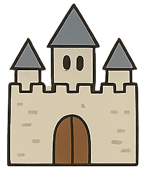
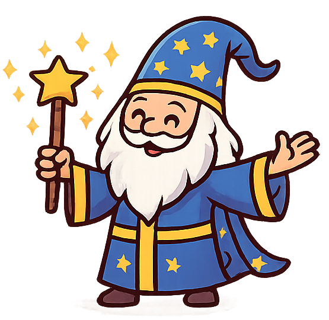
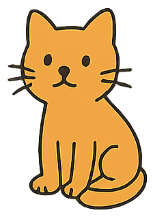
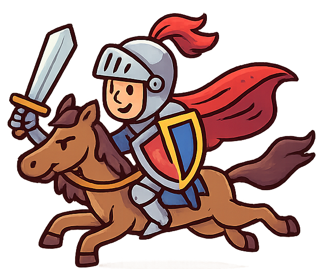

# An Incoherence Adventure

Once upon a time, there was a castle on a hill.

A dragon flew down and blocked the gate.

The scientist looked at the map and said, "The treasure is in the forest."

A pirate ran in and shouted, "Let’s go to space!"

The team climbed into a rocket and blasted off.

In the forest, the detective found a ghost and a hidden alien.

They opened the treasure chest and found the Moonstone.

The wizard smiled, the cat sat on the treasure, and the knight cheered.

The adventure ended with a happy kingdom and a shining treasure.

